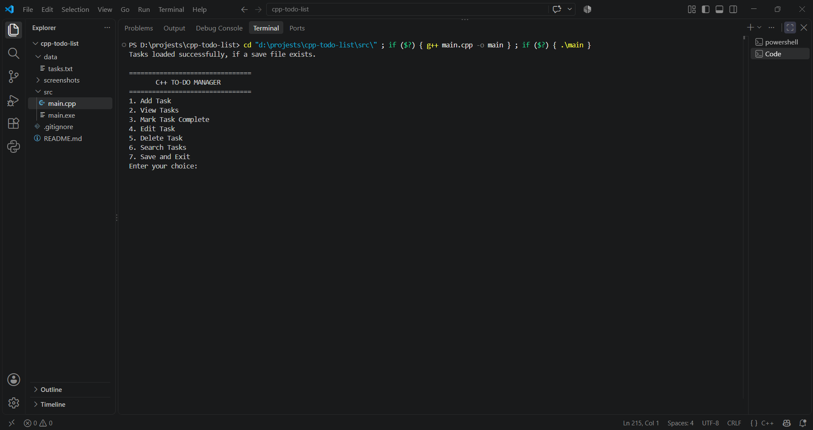
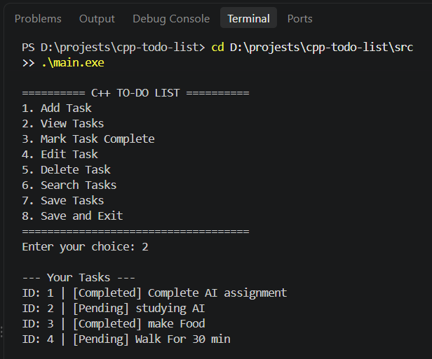
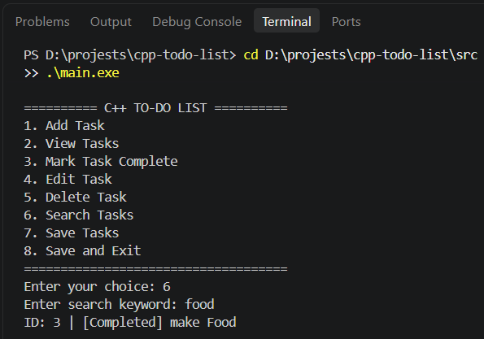

# C++ To-Do List

A console-based To-Do List application built using C++. It allows users to manage daily tasks through an interactive menu, with persistent storage using file handling.

## Features

- Add new tasks
- View all tasks
- Mark tasks as completed
- Edit existing tasks
- Delete tasks
- Search tasks by title (case-insensitive)
- Save tasks to a file
- Load saved tasks when the application starts
- Validate user input
- Handle file-loading and saving errors

## Technologies Used

- **Language:** C++
- **Concepts:** Object-oriented programming (classes and objects), encapsulation, vectors, functions, loops, conditional statements, input validation, and file handling
- **Compiler:** GCC (g++)
- **C++ Standard:** C++17

## Project Structure

```text
cpp-todo-list/
├── src/
│   ├── main.cpp
│   ├── Task.h
│   ├── Task.cpp
│   ├── TodoList.h
│   └── TodoList.cpp
├── data/
│   └── .gitkeep
├── screenshots/
│   ├── main-menu.png
│   ├── task-management.png
│   └── search-results.png
├── .gitignore
└── README.md
```

## Requirements

- GCC compiler with C++17 support
- Terminal or code editor such as Visual Studio Code
- Compatible Windows, Linux, or macOS environment

## How to Run

### 1. Clone the Repository

```bash
git clone https://github.com/dhruv1o7/cpp-todo-list.git
cd cpp-todo-list
```

### 2. Compile the Program

Open the terminal in the `src` directory:

```bash
cd src
g++ -std=c++17 main.cpp Task.cpp TodoList.cpp -o main
```

### 3. Run the Application

**Windows PowerShell**

```powershell
.\main.exe
```

**Linux/macOS**

```bash
./main
```

**Note:** Run the application from the `src` directory. The application currently uses the relative path `../data/tasks.txt` for task storage.

## Screenshots

### Main Menu



### Task Management



### Searching Tasks



## Learning Outcomes

- Applied object-oriented programming using classes and objects.
- Used encapsulation to organize task data and operations.
- Used `std::vector` to store and manage multiple tasks.
- Implemented file handling to save and load tasks.
- Practiced input validation and error handling.
- Organized a multi-file C++ project using header and implementation files.
- Used Git and GitHub for version control and project hosting.

## Future Improvements

- Add task deadlines and priorities.
- Implement task sorting and filtering.
- Improve file storage reliability.
- Add automated unit tests.
- Develop a graphical user interface.

## Author

**Dhruv Bhatkar**

B.Tech Computer Science and Engineering  
Specialization: Artificial Intelligence and Machine Learning

GitHub: [@dhruv1o7](https://github.com/dhruv1o7)
