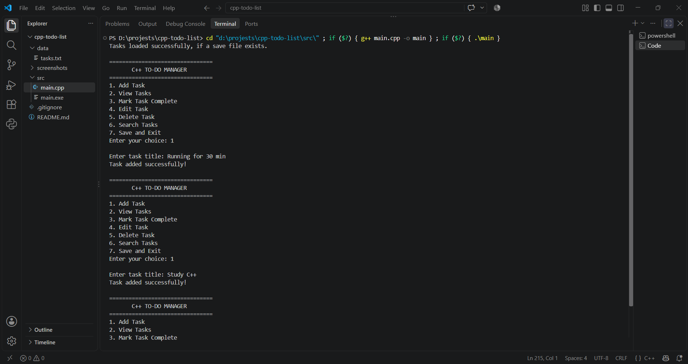
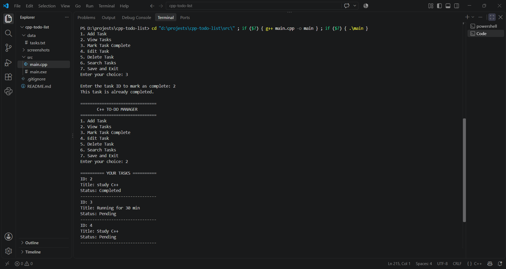

# C++ To-Do List

A simple console-based To-Do List application built using C++. This project helps users manage daily tasks through an interactive menu.

## Features

* Add new tasks
* View all tasks
* Mark tasks as completed
* Edit existing tasks
* Delete tasks
* Search tasks by title
* Save tasks to a file
* Load saved tasks when the application starts

## Technologies Used

* **Language:** C++
* **Concepts:** Structures, vectors, functions, loops, conditional statements, and file handling
* **Compiler:** GCC (g++)

## Project Structure

```text
cpp-todo-list/
├── src/
│   └── main.cpp
├── data/
│   └── .gitkeep
├── screenshots/
├── .gitignore
└── README.md
```

## How to Run

### Requirements

* A C++ compiler such as GCC
* A terminal or code editor such as Visual Studio Code

### Steps

1. Open the `src` folder in your terminal.

2. Compile the program:

   ```bash
   g++ -std=c++17 main.cpp -o main
   ```

3. Run the application:

   **Windows PowerShell**

   ```powershell
   .\main
   ```

   **Linux/macOS**

   ```bash
   ./main
   ```

**Note:** The current program uses a relative path to store task data. Run it from the `src` directory so saved tasks are written to the project's `data` folder.

## Learning Outcomes

* Practiced organizing C++ programs using functions and structures.
* Used vectors to store and manage tasks.
* Implemented file handling to save and load data.
* Built a menu-driven command-line application.

## Future Improvements

* Add task deadlines and priorities.
* Improve input validation.
* Add a graphical user interface.

## Screenshots

### Main Menu


### Task List


### Completed Task


## Author

Dhruv Bhatkar

B.Tech Computer Science and Engineering — Artificial Intelligence and Machine Learning
